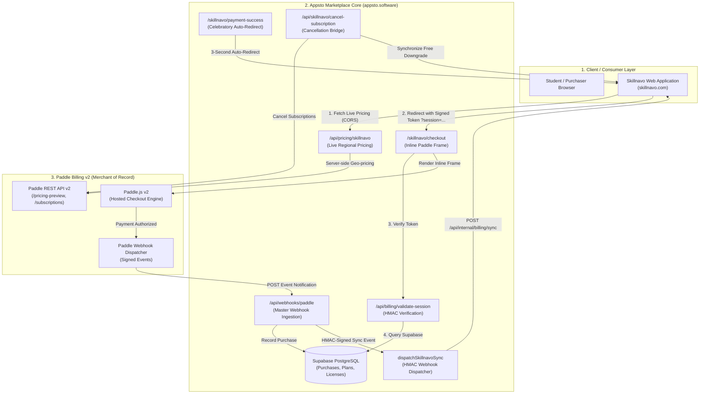
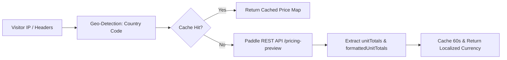
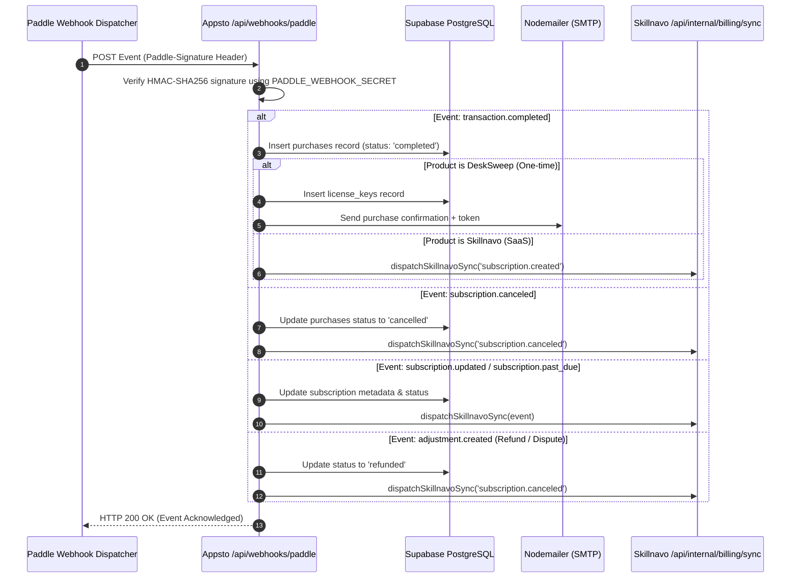
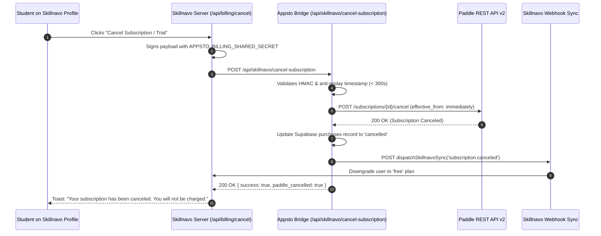
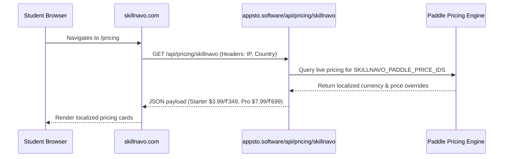
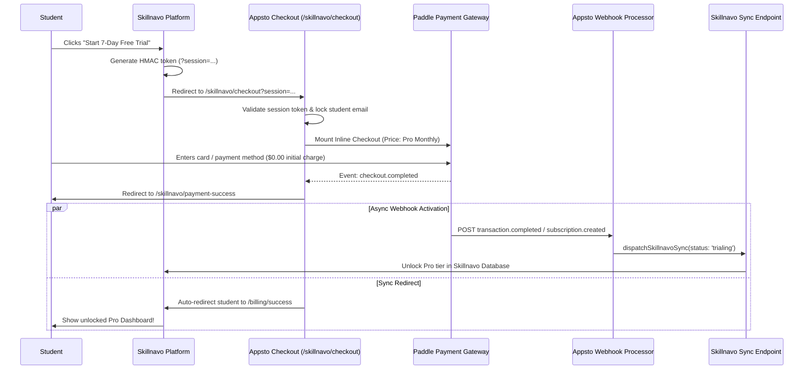

# Appsto Platform: Complete System Architecture, Paddle Billing v2 & Skillnavo Integration Manual

> **Document Version**: 2.5.0  
> **Last Updated**: September 2026  
> **Author**: Appsto Engineering  
> **Target Audience**: AI Agents, Full-Stack Engineers, System Architects, DevOps  

---

## Table of Contents
1. [Executive Summary & Platform Purpose](#1-executive-summary--platform-purpose)
2. [High-Level System Architecture](#2-high-level-system-architecture)
3. [Technology Stack & Core Components](#3-technology-stack--core-components)
4. [Paddle Billing v2 Engine Architecture](#4-paddle-billing-v2-engine-architecture)
   - 4.1 [Merchant of Record (MoR) Foundation](#41-merchant-of-record-mor-foundation)
   - 4.2 [Products, Plans & Pricing Structure](#42-products-plans--pricing-structure)
   - 4.3 [Dual-Tier Pricing Engine (Server + Client)](#43-dual-tier-pricing-engine-server--client)
   - 4.4 [Checkout Experiences: Overlay vs. Inline](#44-checkout-experiences-overlay-vs-inline)
   - 4.5 [Saved Payment Methods & Customer Auth Tokens](#45-saved-payment-methods--customer-auth-tokens)
   - 4.6 [Master Paddle Webhook Processor](#46-master-paddle-webhook-processor)
   - 4.7 [Automated Background Crons](#47-automated-background-crons)
5. [The Skillnavo Connection & Bridge Architecture](#5-the-skillnavo-connection--bridge-architecture)
   - 5.1 [Why the Bridge Exists](#51-why-the-bridge-exists)
   - 5.2 [Touchpoint 1: Live Pricing API (`GET /api/pricing/skillnavo`)](#52-touchpoint-1-live-pricing-api-get-apipricingskillnavo)
   - 5.3 [Touchpoint 2: HMAC Session Checkout Bridge (`/skillnavo/checkout?session=...`)](#53-touchpoint-2-hmac-session-checkout-bridge-skillnavocheckoutsession)
   - 5.4 [Touchpoint 3: Post-Payment Celebration & Return Flow (`/skillnavo/payment-success`)](#54-touchpoint-3-post-payment-celebration--return-flow-skillnavopayment-success)
   - 5.5 [Touchpoint 4: Real-Time Webhook Forwarding (`dispatchSkillnavoSync`)](#55-touchpoint-4-real-time-webhook-forwarding-dispatchskillnavosync)
   - 5.6 [Touchpoint 5: In-App Subscription & Trial Cancellation Bridge](#56-touchpoint-5-in-app-subscription--trial-cancellation-bridge)
6. [End-to-End Sequence Diagrams](#6-end-to-end-sequence-diagrams)
   - 6.1 [Pricing Discovery & Regional Negotiation](#61-pricing-discovery--regional-negotiation)
   - 6.2 [Student Checkout & Instant Tier Unlock](#62-student-checkout--instant-tier-unlock)
   - 6.3 [7-Day Trial Cancellation Flow](#63-7-day-trial-cancellation-flow)
7. [Security, Cryptography & Anti-Tampering Protocol](#7-security-cryptography--anti-tampering-protocol)
8. [Database Schema & Data Models (Supabase)](#8-database-schema--data-models-supabase)
9. [Environment Variables Reference](#9-environment-variables-reference)
10. [Troubleshooting & Maintenance Runbook](#10-troubleshooting--maintenance-runbook)

---

## 1. Executive Summary & Platform Purpose

**Appsto (`appsto.software`)** is a next-generation software marketplace, licensing gateway, and Merchant of Record (MoR) billing infrastructure built on **Next.js (App Router)** and **Supabase**.

The platform is designed around a **dual business model**:
1. **Proprietary Desktop Software (One-Time Purchases)**: 
   - Flagship product: **DeskSweep** (smart desktop organizer).
   - Model: Lifetime licenses across three tiers (Solo, Squad, Studio).
   - Fulfillment: Cryptographically generated hardware/device license tokens (`APPSTO-XXXX-XXXX-XXXX`), automated HTML email delivery, and a masked binary download proxy (`/api/download/[product]`).
2. **External SaaS Billing & Subscription Gateway (Recurring SaaS)**:
   - Flagship partner: **Skillnavo (`skillnavo.com`)** (AI-powered engineering roadmap platform).
   - Model: 7-day free trials converting into monthly or annual subscriptions (Starter, Pro).
   - Fulfillment: Seamless tokenized checkout, zero-friction inline payment integration, and cryptographically verified webhook synchronization to grant and revoke instant access.

By functioning as the centralized **Merchant of Record**, Appsto removes all sales tax, VAT, cross-border remittance, and fraud liability from external partner platforms like Skillnavo.

---

## 2. High-Level System Architecture



---

## 3. Technology Stack & Core Components

| Component | Technology | Role / Purpose |
| :--- | :--- | :--- |
| **Framework** | Next.js 15+ (App Router) | High-performance server-rendered frontend and serverless API endpoints. |
| **Language** | TypeScript 5.3+ | End-to-end type safety across Paddle payloads, database models, and sync events. |
| **UI Styling** | Tailwind CSS 3.4 & Framer Motion | Fluid typography, glassmorphism, responsive 2-column checkout grid, shimmer skeletons. |
| **Database & Auth** | Supabase (PostgreSQL) | Stores purchases, plans, products, customer mappings, and audit logs with RLS. |
| **Payment Engine** | Paddle Billing v2 | Global Merchant of Record (MoR) handling multi-currency processing and subscriptions. |
| **Email Delivery** | Nodemailer (Gmail SMTP) | Transactional receipt emails and license key delivery for one-time purchases. |
| **Observability** | Sentry & Discord Webhooks | Production error tracking and instant Discord sales alerts (`DISCORD_WEBHOOK_SALES`). |

---

## 4. Paddle Billing v2 Engine Architecture

Appsto uses **Paddle Billing v2** (the modern API-first iteration of Paddle), rather than legacy Paddle Classic.

### 4.1 Merchant of Record (MoR) Foundation
As an MoR integration:
- Paddle is the legal seller of the software.
- The student's bank statement reads: `PADDLE.NET* APPSTO`.
- Paddle collects and remits sales taxes/VAT across 200+ jurisdictions automatically.
- Appsto and Skillnavo are indemnified against chargebacks, fraudulent cards, and local compliance audits.

### 4.2 Products, Plans & Pricing Structure

The system differentiates two product classes via database records and `product_slug`:

#### DeskSweep (Desktop App — One-Time)
- **Product ID**: `pro_01khb6y9s1f2y7j3a9b2c3d4e5`
- **Prices**:
  - Solo (1 Device): `pri_01khb858xxexa8chhc45gvdvwk` ($9.99)
  - Squad (3 Devices): `pri_01khb8e6ez5hm3afq5y39ksx4c` ($19.99)
  - Studio (10 Devices): `pri_01khb8rm4c5rs6vxw4byzyhhnw` ($39.99)

#### Skillnavo AI (Cloud SaaS — Recurring Subscriptions)
- **Product ID**: `pro_01m2524ck45ckjmnh6yam91w01`
- **Prices**:
  - Starter Monthly: `pri_01m252y0prb2nrjmay8ecgc1q0` ($3.99 / mo)
  - Starter Annual: `pri_01m2531e1n85b5hx6zfmphp1rz` ($39.99 / yr)
  - Pro Monthly: `pri_01m2535m78g4tpvj5bwzvnbhhh` ($7.99 / mo)
  - Pro Annual: `pri_01m2538wa1msvncrk76528d433` ($79.99 / yr)

---

### 4.3 Dual-Tier Pricing Engine (Server + Client)

To guarantee that prices displayed across the marketing pages, API endpoints, and checkout forms are **100% identical to Paddle's real-time checkout calculations**:



1. **Server-Side (`src/lib/paddle-server-api.ts`)**:
   - Hits `https://api.paddle.com/pricing-preview`.
   - Passes customer country detected from `cf-ipcountry` (Cloudflare) or `x-vercel-ip-country` (Vercel).
   - Extracts localized symbol, amount, and formatted string (e.g. `₹349.00`, `$3.99`, `€3.75`).
   - Caches data in-memory with a 60-second TTL to avoid hitting Paddle rate limits.
2. **Client-Side (`src/hooks/usePaddlePrices.ts`)**:
   - Uses `window.Paddle.PricePreview({ items })` for marketing pages (`/products`).
   - Ensures regional prices reflect the visitor's live IP before they ever open checkout.

---

### 4.4 Checkout Experiences: Overlay vs. Inline

Appsto implements two distinct checkout experiences tailored to user intent:

| Attribute | DeskSweep (`/products/[slug]`) | Skillnavo (`/skillnavo/checkout`) |
| :--- | :--- | :--- |
| **Display Mode** | `overlay` (Modal window) | `inline` (Embedded directly in page) |
| **Visual Target** | Centered floating modal | Dedicated `#paddle-checkout-container` element |
| **Email Handling** | Prefilled or prompted on checkout | **Strictly locked** to authenticated student email |
| **Brand Presence** | Appsto Storefront context | Dual branding: Appsto + Skillnavo Official |
| **Custom Data** | `{ product_slug: 'desksweep', plan_slug }` | `{ product_slug: 'skillnavo', skillnavo_user_id, plan_id, return_to }` |
| **Success Action** | Redirect to `/purchase/success` | 3-second celebratory auto-redirect back to Skillnavo |

#### Paddle.js v2 Inline Integration Safeguards in `skillnavo/checkout`:
1. **Singleton Guard**: Paddle.js v2 disallows calling `Paddle.Initialize()` more than once. The checkout page checks `window.Paddle.Initialized` before initializing and uses `Paddle.Update({ eventCallback })` if Paddle was already mounted.
2. **Environment Order**: `Paddle.Environment.set('sandbox')` is executed **before** `Paddle.Initialize()` to prevent token mismatch.
3. **DOM MutationObserver**: Attaches directly to `#paddle-checkout-container`. The exact millisecond Paddle injects the `<iframe>`, the loading overlay is dismissed.
4. **Fail-Safe Timer**: A 3.5-second timer automatically clears loading screens if ad-blockers delay `checkout.loaded`.
5. **Overlay Fallback**: A one-click secondary option ("Open in modal window") allows users with strict iframe-blocking extensions to complete payment without friction.

---

### 4.5 Saved Payment Methods & Customer Auth Tokens

For repeat purchasers, Appsto provides 1-click checkout via `/api/paddle/customer-token`:
1. Appsto checks Supabase for an existing `paddle_customer_id` associated with the user's email.
2. If found, Appsto calls Paddle API (`POST /customers/{id}/auth-tokens`).
3. The resulting token is passed to `Paddle.Checkout.open({ customerAuthToken })`.
4. The user sees their saved credit cards / Apple Pay credentials ready to authorize with one click.

---

### 4.6 Master Paddle Webhook Processor

Endpoint: `POST /api/webhooks/paddle` (`src/app/api/webhooks/paddle/route.ts`)

Every transaction, subscription renewal, trial start, update, cancellation, and refund passes through this secure ingestion point.



#### Paddle Webhook Security Features:
- **Signature Verification**: Verifies `Paddle-Signature` header (`ts=...;h1=...`) using the raw unparsed request body and `PADDLE_WEBHOOK_SECRET`.
- **Anti-Replay**: Rejects webhook events older than 5 seconds (`tolerance: 5`).
- **Trial-Aware Validation**: Detects 7-day free trial transactions ($0.00 initial charge) and allows zero-amount items to activate subscriptions while strictly rejecting invalid non-trial $0 orders.

---

### 4.7 Automated Background Crons

1. **Abandoned Checkout Recovery (`/api/cron/recover-abandoned`)**:
   - Runs every 30 minutes.
   - Detects users who began checkout (`/api/billing/track-checkout`) but didn't trigger `transaction.completed` within 1 hour.
   - Dispatches a personalized email with an automatic 10% discount checkout link (`coupon=LEARN10`).
2. **Paddle Product Synchronization (`/api/cron/sync-paddel-products`)**:
   - Syncs active price IDs, catalog metadata, and currency matrices between Paddle Dashboard and the Supabase database.

---

## 5. The Skillnavo Connection & Bridge Architecture

### 5.1 Why the Bridge Exists
Skillnavo (`skillnavo.com`) is a dedicated learning platform for developers. Rather than implementing its own billing logic, tax compliance, and PCI-DSS payment handlers, Skillnavo offloads the entire subscription and checkout lifecycle to Appsto.

### 5.2 Touchpoint 1: Live Pricing API (`GET /api/pricing/skillnavo`)

- **File**: `src/app/api/pricing/skillnavo/route.ts`
- **CORS**: Explicitly allows `skillnavo.com`, `www.skillnavo.com`, and `appsto.software`.
- **Purpose**: Powers Skillnavo's pricing cards live in real-time.
- **Capabilities**:
  - Automatically detects student country from headers.
  - Returns plan definitions, feature matrices, localized currency symbols (`$`, `₹`, `€`), formatted prices, and instant checkout URLs.
  - Returns `Cache-Control: no-store` to guarantee zero stale price displays.

---

### 5.3 Touchpoint 2: HMAC Session Checkout Bridge (`/skillnavo/checkout?session=...`)

When a student clicks "Get Pro" on Skillnavo:
1. Skillnavo generates a signed checkout token:
   ```text
   session = <base64UrlPayload>.<hmacSignature>
   ```
2. The payload contains:
   ```json
   {
     "skillnavo_user_id": "usr_948201",
     "email": "student@university.edu",
     "plan": "pro_monthly",
     "return_to": "/dashboard",
     "iat": 1726000000,
     "exp": 1726000900
   }
   ```
3. The student is redirected to:
   ```text
   https://appsto.software/skillnavo/checkout?session=${session}
   ```
4. Appsto's backend endpoint `/api/billing/validate-session`:
   - Validates the signature using `APPSTO_BILLING_SHARED_SECRET`.
   - Checks expiration (`exp < now`, 15-minute window).
   - Locks the customer email in the checkout form so it cannot be altered.

---

### 5.4 Touchpoint 3: Post-Payment Celebration & Return Flow (`/skillnavo/payment-success`)

- **File**: `src/app/skillnavo/payment-success/page.tsx`
- **Behavior**:
  1. Once Paddle confirms payment, it redirects the student to `/skillnavo/payment-success?session=...`.
  2. Displays an ultra-clean, celebratory confirmation screen with an animated emerald checkmark and countdown timer.
  3. Displays the verified account email.
  4. Automatically navigates the student back to Skillnavo after 3 seconds:
     ```text
     https://skillnavo.com/billing/success?tier=pro&returnTo=/dashboard&session=...
     ```

---

### 5.5 Touchpoint 4: Real-Time Webhook Forwarding (`dispatchSkillnavoSync`)

- **File**: `src/lib/skillnavo-sync.ts`
- When Appsto's webhook receiver processes any subscription change, it calls `dispatchSkillnavoSync()`:
  - **Target**: `https://skillnavo.com/api/internal/billing/sync`
  - **Security**: HMAC-SHA256 signature passed in `X-Appsto-Signature` with timestamp in `X-Appsto-Timestamp`.
  - **Payload**:
    ```json
    {
      "event": "subscription.created",
      "event_id": "txn_01k..._tx_completed",
      "subscription_id": "sub_01m...",
      "customer_id": "ctm_01k...",
      "customer_email": "student@university.edu",
      "customer_name": "Student Name",
      "skillnavo_user_id": "usr_948201",
      "plan": "pro_monthly",
      "status": "trialing",
      "current_period_end": "2026-09-24T12:00:00.000Z",
      "cancel_at_period_end": false
    }
    ```
  - **Retry Queue**: Automated 3-tier exponential backoff (retry on failure after 1.5s, 3s).

---

### 5.6 Touchpoint 5: In-App Subscription & Trial Cancellation Bridge

- **File**: `src/app/api/skillnavo/cancel-subscription/route.ts`
- Enables students to cancel their 7-day trial or paid subscription **directly from their profile inside Skillnavo without leaving the site**:



---

## 6. End-to-End Sequence Diagrams

### 6.1 Pricing Discovery & Regional Negotiation



---

### 6.2 Student Checkout & Instant Tier Unlock



---

## 7. Security, Cryptography & Anti-Tampering Protocol

Appsto enforces strict enterprise-grade security across all integration boundaries:

1. **HMAC-SHA256 Token Verification**:
   - Used for `session` tokens and server-to-server sync calls.
   - Calculated as: `HMAC_SHA256(sharedSecret, timestamp + "." + rawBody)`.
2. **Timing-Safe Buffers**:
   - All cryptographic comparisons use `crypto.timingSafeEqual()` to eliminate side-channel timing attacks.
3. **Anti-Replay Window**:
   - Requests with timestamp drifts exceeding 300 seconds (5 minutes) are immediately dropped with HTTP 401.
4. **Token Expiration**:
   - Checkout sessions contain an explicit `exp` claim (15-minute maximum lifetime).
5. **Customer Email Lock**:
   - When arriving via a signed session token, the email in Paddle checkout is prefilled and locked (`allowLogout: false`), preventing a student from paying with one account to unlock another.

---

## 8. Database Schema & Data Models (Supabase)

### `public.purchases`
Stores every financial transaction and subscription record across both products.

| Column | Type | Description |
| :--- | :--- | :--- |
| `id` | `uuid` (PK) | Unique Appsto purchase identifier. |
| `user_id` | `uuid` (FK, Nullable) | Linked Appsto user ID (if registered). |
| `product_id` | `uuid` (FK) | Reference to `products.id`. |
| `pricing_plan_id` | `uuid` (FK) | Reference to `pricing_plans.id`. |
| `paddle_transaction_id` | `text` (Unique) | Paddle Transaction ID (`txn_...`). |
| `paddle_subscription_id`| `text` (Nullable) | Paddle Subscription ID (`sub_...`) for Skillnavo. |
| `paddle_customer_id` | `text` | Paddle Customer ID (`ctm_...`). |
| `amount` | `numeric(10,2)` | Paid amount (e.g. `0.00` for trials, `7.99`). |
| `currency` | `text` | 3-letter currency code (`USD`, `INR`, `EUR`). |
| `status` | `text` | `completed`, `trialing`, `cancelled`, `refunded`. |
| `customer_email` | `text` | Buyer / Student email address. |
| `metadata` | `jsonb` | Full Paddle data, customData, and sync logs. |

### `public.pricing_plans`
Defines tiers and links them to Paddle price IDs.

| Column | Type | Description |
| :--- | :--- | :--- |
| `id` | `uuid` (PK) | Plan identifier. |
| `product_id` | `uuid` (FK) | Associated product. |
| `plan_name` | `text` | Display name (e.g. `Pro Monthly`, `Solo`). |
| `plan_slug` | `text` | URL/Sync key (e.g. `pro_monthly`, `solo`). |
| `price` | `numeric(10,2)` | Default USD price. |
| `billing_period` | `text` | `one_time`, `monthly`, `annual`. |
| `paddle_price_id_usd` | `text` | Primary Paddle Price ID (`pri_...`). |

---

## 9. Environment Variables Reference

```bash
# -----------------------------------------------------------------------------
# APPSTO PLATFORM CONFIGURATION
# -----------------------------------------------------------------------------
NEXT_PUBLIC_SITE_URL=https://appsto.software
NEXT_PUBLIC_APP_URL=https://appsto.software

# -----------------------------------------------------------------------------
# SUPABASE DATABASE & AUTH
# -----------------------------------------------------------------------------
NEXT_PUBLIC_SUPABASE_URL=https://xxxxxxxxxxxxxxxxxxxx.supabase.co
NEXT_PUBLIC_SUPABASE_ANON_KEY=eyJhbGciOi...
SUPABASE_SERVICE_ROLE_KEY=eyJhbGciOi...

# -----------------------------------------------------------------------------
# PADDLE BILLING v2 CONFIGURATION
# -----------------------------------------------------------------------------
NEXT_PUBLIC_PADDLE_ENVIRONMENT=production    # 'sandbox' or 'production'
NEXT_PUBLIC_PADDLE_VENDOR_ID=283136
NEXT_PUBLIC_PADDLE_CLIENT_TOKEN=live_d7847f9aa083b449ac00ca5849f
PADDLE_API_KEY=pdl_live_apikey_01khbg...
PADDLE_WEBHOOK_SECRET=pdl_ntfset_01khbf...

# -----------------------------------------------------------------------------
# SKILLNAVO INTEGRATION BRIDGE
# -----------------------------------------------------------------------------
SKILLNAVO_SYNC_URL=https://skillnavo.com/api/internal/billing/sync
APPSTO_BILLING_SHARED_SECRET=ef04fe0cc297b7b4263e40f914d7aaecskillnavosharedsecret
NEXT_PUBLIC_PADDLE_PRODUCT_SKILLNAVO=pro_01m2524ck45ckjmnh6yam91w01
NEXT_PUBLIC_PADDLE_PRICE_STARTER_MONTHLY=pri_01m252y0prb2nrjmay8ecgc1q0
NEXT_PUBLIC_PADDLE_PRICE_STARTER_ANNUAL=pri_01m2531e1n85b5hx6zfmphp1rz
NEXT_PUBLIC_PADDLE_PRICE_PRO_MONTHLY=pri_01m2535m78g4tpvj5bwzvnbhhh
NEXT_PUBLIC_PADDLE_PRICE_PRO_ANNUAL=pri_01m2538wa1msvncrk76528d433

# -----------------------------------------------------------------------------
# TRANSACTIONAL EMAILS & NOTIFICATIONS
# -----------------------------------------------------------------------------
SMTP_HOST=smtp.gmail.com
SMTP_PORT=587
SMTP_USER=helpappsto@gmail.com
SMTP_PASSWORD=xxxx xxxx xxxx xxxx
EMAIL_FROM=support@appsto.software
DISCORD_WEBHOOK_SALES=https://discord.com/api/webhooks/...
```

---

## 10. Troubleshooting & Maintenance Runbook

### Issue: "Checkout is spinning forever on /skillnavo/checkout"
1. **Diagnosis**: Check the browser console. If `Paddle.Initialize()` was called twice or `usePaddlePrices()` was mounted simultaneously, the second `eventCallback` was dropped by Paddle.js v2.
2. **Resolution**: Ensure `usePaddlePrices` is NOT imported on the checkout page. The checkout page must initialize Paddle once with `displayMode: 'inline'` and `frameTarget: 'paddle-checkout-container'`.

### Issue: "Skillnavo user paid, but tier was not unlocked"
1. **Diagnosis**: Check Appsto logs for `dispatchSkillnavoSync`.
2. **Common causes**:
   - `APPSTO_BILLING_SHARED_SECRET` in Skillnavo `.env` does not match Appsto.
   - Skillnavo's `/api/internal/billing/sync` endpoint returned non-200.
   - Appsto retries 3 times automatically; inspect Supabase `purchases.metadata.sync_error` for the exact HTTP status returned by Skillnavo.

### Issue: "Student cancelled subscription, but was charged on Day 7"
1. **Diagnosis**: Verify whether cancellation was executed via `/api/skillnavo/cancel-subscription`.
2. **Resolution**: Check the Paddle Dashboard (`Subscriptions -> View Subscription`). If the subscription shows `Canceled` or `Paused`, Paddle will **never** charge the student's card. Ensure `effective_from: 'immediately'` was sent in the cancellation payload.

---

*This document is the authoritative engineering manual for Appsto, Paddle, and Skillnavo billing integrations.*
